<div align="center">


# sezgi.live

**Her gün 5 kısa algı oyunu. Gözüne, kulağına ve iç saatine ne kadar güveniyorsun?**

Tamamen Türkçe · Üyelik yok · Telefonda ve bilgisayarda · Açık ve koyu tema

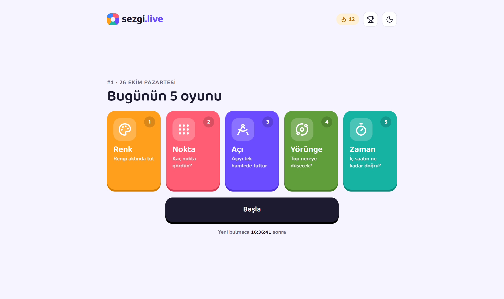

</div>

---

## Nedir?

sezgi.live, algını ölçen günlük bir oyun sitesi. Her gün 8 oyunluk havuzdan **5 oyun** seçilir ve o gün **herkes aynı soruları** oynar: aynı nokta sayısını, aynı açıyı, aynı üçgeni görür. Böylece skorunu arkadaşlarınla gerçekten karşılaştırabilirsin.

Bir günü bitirmek 3-4 dakika sürer. Gece yarısı (Türkiye saatiyle) yeni bulmaca gelir.

## Oyunlar

| | Oyun | Ne yapıyorsun? |
|---|---|---|
| 🔴 | **Nokta** | Ekranda 2 saniye beliren noktaların sayısını tahmin et. Saymaya vaktin yok, göz kararı! |
| 🟣 | **Açı** | Kesikli çizgiden istenen açıyı tek hamlede kur. Bıraktığın an kaydedilir. |
| 🟢 | **Zaman** | Sayaç yok. "6,4 saniye" geçti dediğin an dur. İç saatin ne kadar doğru? |
| 🟠 | **Renk** | 2 saniye gördüğün rengi renk kutusunda yeniden bul. |
| 🔵 | **Merkez** | Bir üçgenin denge noktasına, yani kartondan kesilse parmağında duracağı yere dokun. |
| 🟩 | **Yörünge** | Fırlatılan top havada kaybolur. Yere nereye düşeceğini tahmin et. |
| 🩷 | **Ritim** | 4 vuruşa eşlik et, ses kesilince aynı tempoyla 8 kez daha dokun. |
| ⚪ | **Oran** | Bir çizgide "başlangıçtan 4/9 uzaklıktaki" noktayı cetvelsiz bul. |

<table>
  <tr>
    <td width="25%">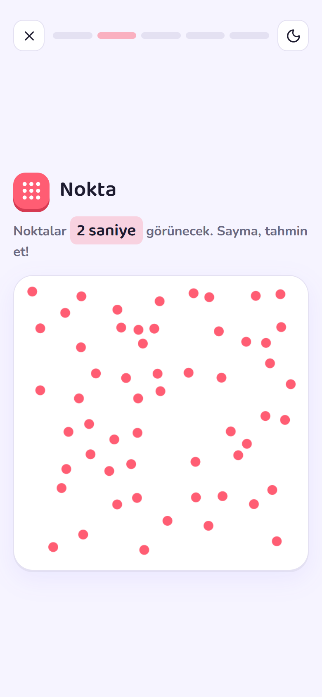</td>
    <td width="25%">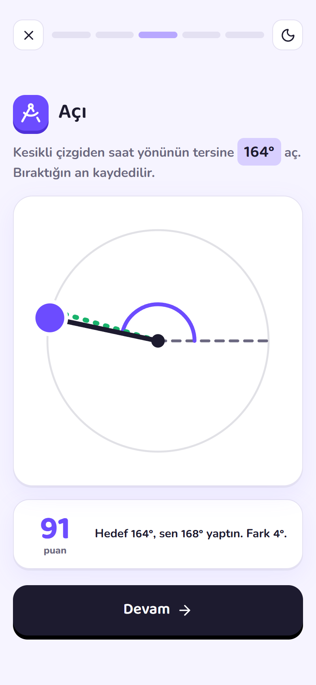</td>
    <td width="25%">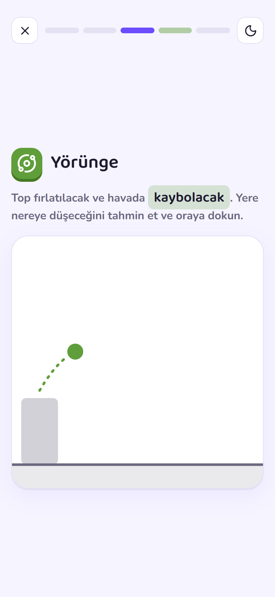</td>
    <td width="25%">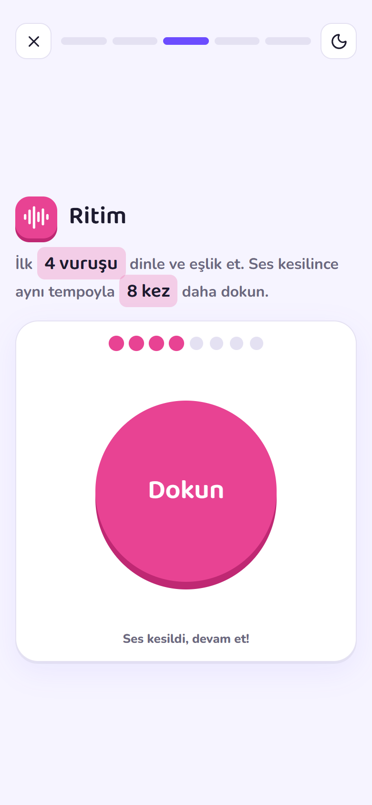</td>
  </tr>
  <tr>
    <td align="center"><b>Nokta</b></td>
    <td align="center"><b>Açı</b></td>
    <td align="center"><b>Yörünge</b></td>
    <td align="center"><b>Ritim</b></td>
  </tr>
  <tr>
    <td>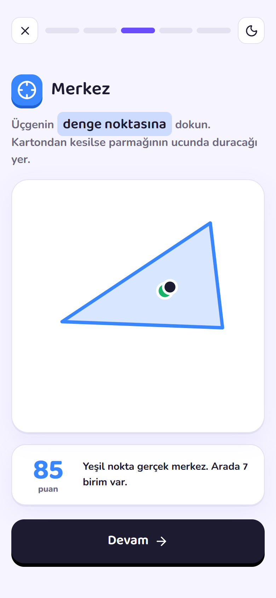</td>
    <td>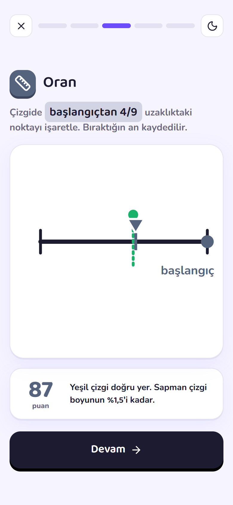</td>
    <td>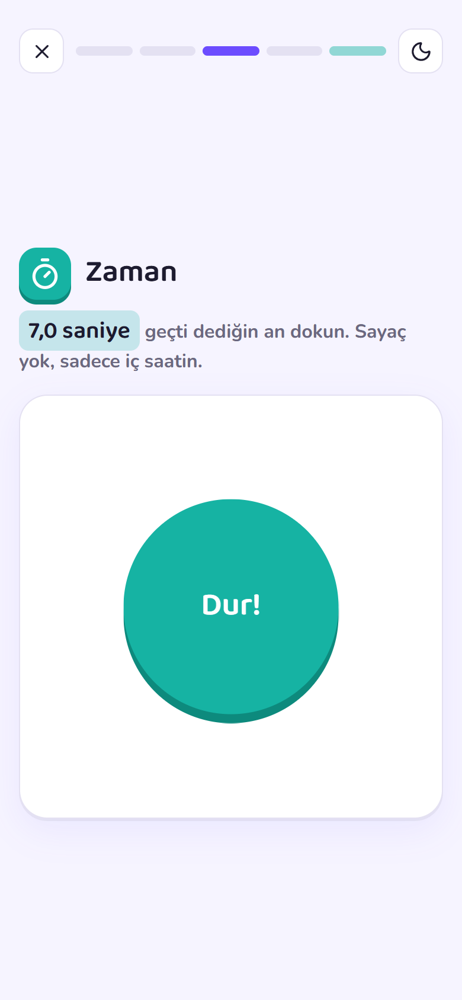</td>
    <td>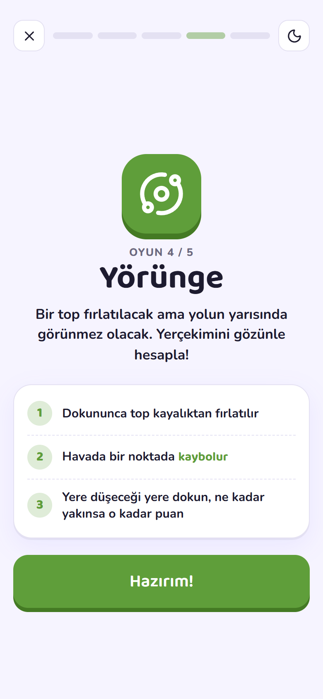</td>
  </tr>
  <tr>
    <td align="center"><b>Merkez</b></td>
    <td align="center"><b>Oran</b></td>
    <td align="center"><b>Zaman</b></td>
    <td align="center"><b>Her oyundan önce kısa tanıtım</b></td>
  </tr>
</table>

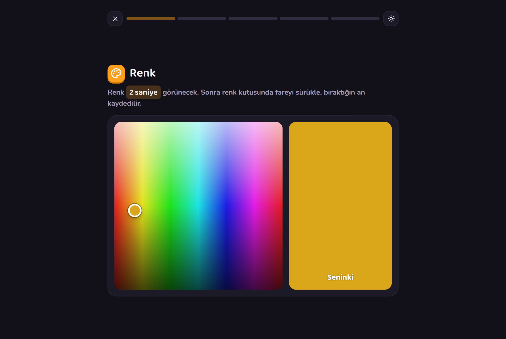
<p align="center"><sub>Renk oyunu: bilgisayarda geniş oyun alanı ve koyu tema</sub></p>

## Nasıl oynanır?

1. Ana sayfada bugünün 5 oyununu gör ve **Başla**'ya bas.
2. Her oyundan önce kısa bir tanıtım ekranı oyunu anlatır. Hazır olunca **Hazırım!** de.
3. Cevabını ver; doğru cevap ve aldığın puan hemen gösterilir.
4. 5 oyun bitince günün puanını, rütbeni ve sıralamadaki yerini gör.
5. Sonucunu tek dokunuşla WhatsApp, X ya da istediğin yere paylaş.

> Bir oyuna başladıktan sonra sayfayı yenilersen ya da çıkarsan o oyun **0 puan** sayılır. Böylece kimse soruyu görüp yeniden deneyemez.

## Puanlama ve rütbeler

Her oyun **100 puan** üzerinden değerlendirilir; doğru cevaba ne kadar yakınsan o kadar yüksek puan alırsın. Günün puanı, 5 oyunun ortalamasıdır (en fazla 100).

| Günün puanı | Rütbe |
|---|---|
| 90 – 100 | 🦅 Kartal Gözü |
| 76 – 89 | 🎯 Keskin |
| 60 – 75 | 💪 Sağlam |
| 40 – 59 | 🙂 İdare Eder |
| 0 – 39 | 🌫️ Bulanık |

Paylaşım metni şöyle görünür:

```
sezgi.live #12 · 88/100
🎯 Keskin
🟩 Renk 94
🟩 Nokta 88
🟩 Açı 91
🟨 Yörünge 79
🟩 Zaman 86
sezgi.live
```

<table>
  <tr>
    <td width="50%">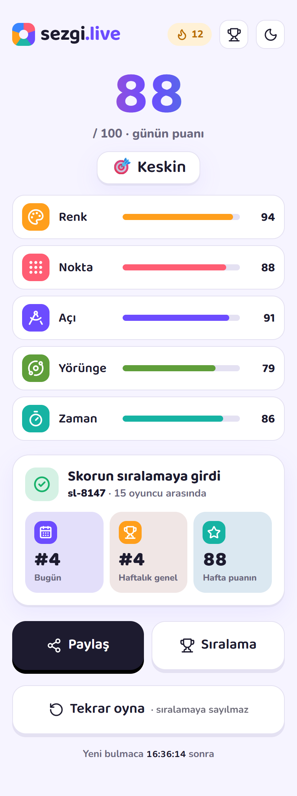</td>
    <td width="50%">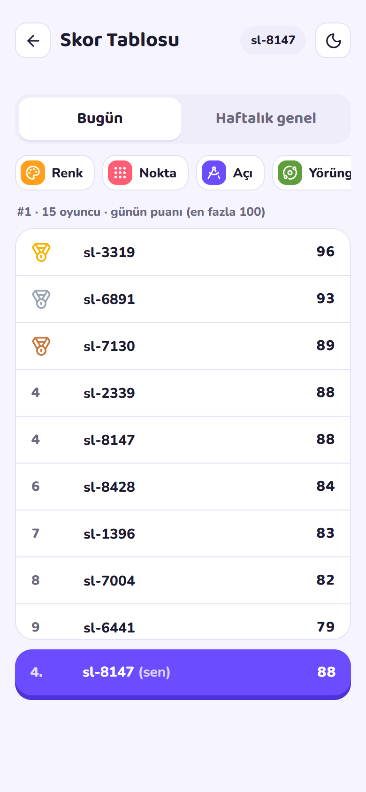</td>
  </tr>
  <tr>
    <td align="center"><b>Sonuç ekranı</b></td>
    <td align="center"><b>Skor tablosu</b></td>
  </tr>
</table>

## Skor tablosu

- **Bugün:** Günün puanına göre ilk 100 oyuncu ve senin sıran.
- **Haftalık genel:** Pazartesiden pazara günlük puanların toplamı (en fazla 700). Her pazartesi sıfırlanır; her gün düzenli oynayan kazanır.
- **Oyun bazlı:** Günün her oyunu için ayrı liste. Bugün Açı'da en iyisi kim?

Eşit puan alanlar aynı sırayı paylaşır; listede önce bitiren üstte görünür.

## Üyelik yok

Kayıt olmana, e-posta vermene gerek yok. Siteye ilk girişte sana **sl-4821** gibi bir takma ad verilir ve tarayıcında hatırlanır. Skor tablosunda bu adla görünürsün. Kişisel bilgi tutulmaz.

Serin (🔥 art arda oynadığın gün sayısı) ve günün ilerlemesi de tarayıcında saklanır.

## Tekrar oyna

Günü bitirdikten sonra da oynamaya devam edebilirsin. **Tekrar oyna** ile günün oyunları yeni sorularla gelir; bu antrenman turları **sıralamaya sayılmaz**, sonunda resmi puanınla karşılaştırabilirsin.

## Her ekranda rahat

<table>
  <tr>
    <td width="40%">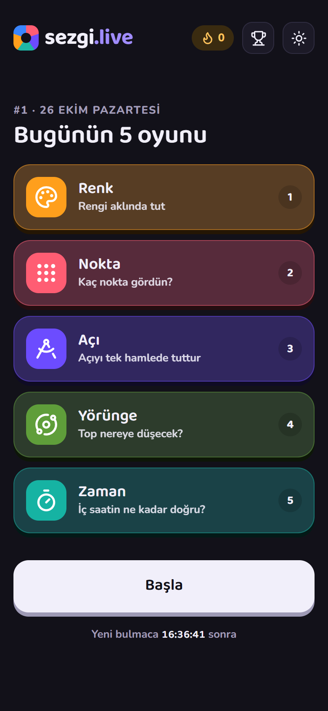</td>
    <td>

- **Telefon ve bilgisayar:** Bilgisayarda oyun alanı genişler, telefonda tek elle oynanır.
- **Açık ve koyu tema:** Cihazının ayarını izler, istersen tek dokunuşla değiştirirsin.
- **Onay yok, akış var:** Açı, Renk ve Oran'da parmağını bıraktığın an cevabın kaydedilir.
- **Türkçe karakterler:** Yazı tipleri ş, ğ, ı, İ dahil tüm Türkçe harfleri destekler.

</td>
  </tr>
</table>

---

<div align="center">
<sub>sezgi.live · Her gün yeni bulmaca</sub>
</div>
